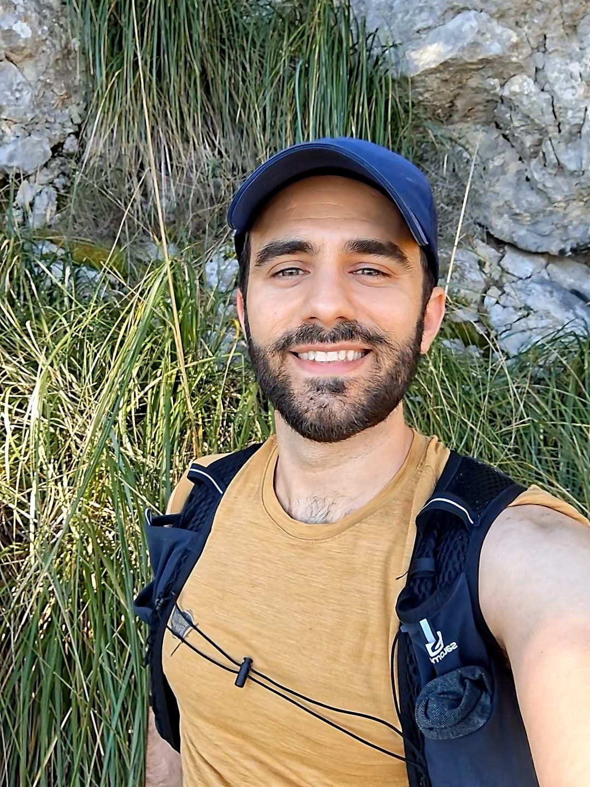
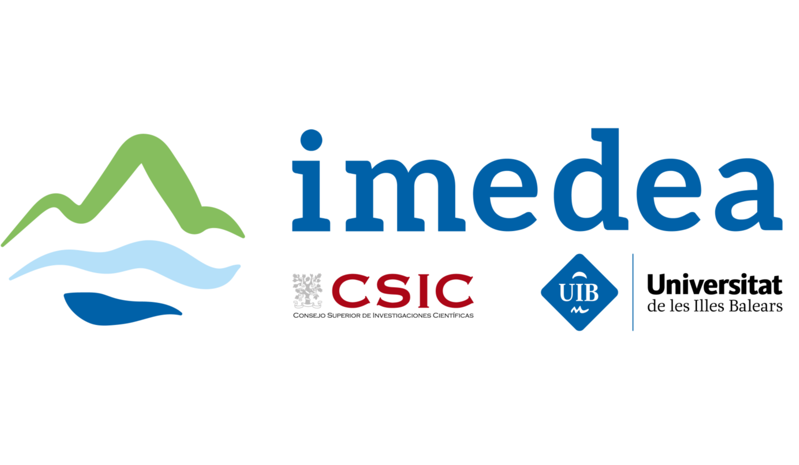
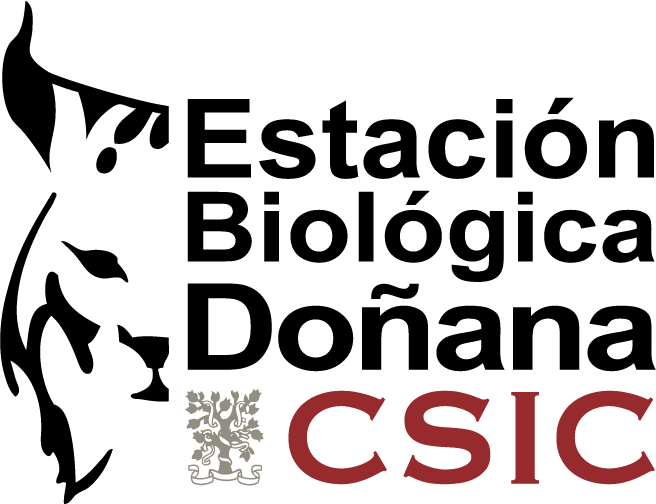

---
title: ""
page-layout: full
css: homepage-vertical.css
---

```{=html}
<div class="academic-home">

  <!-- =====================================================
       LEFT COLUMN: PROFILE
       ===================================================== -->

  <section class="academic-profile" aria-label="About me">

    <!-- Circular portrait -->
    <div class="academic-photo-wrap">
      
    </div>

    <!-- Name -->
    <h1 class="academic-name">
      Jose B. Lanuza<span class="academic-dot">.</span>
    </h1>

    <!-- Academic identity -->
    <p class="academic-eyebrow">
      COMMUNITY ECOLOGIST
    </p>

    <!-- Research keywords -->
    <p class="academic-keywords">
      Plant–pollinator interactions
      <span aria-hidden="true">·</span>
      Network ecology
      <span aria-hidden="true">·</span>
      Global change
    </p>

    <!-- Short biography -->
    <p>
      I study how species interactions shape ecological communities
      and respond to environmental change, combining field ecology,
      ecological network analysis and macroecological approaches.
    </p>


    <!-- =================================================
         SOCIAL AND ACADEMIC ICONS
         ================================================= -->

    <div class="academic-links academic-icon-links">

      <!-- Email -->
      <a
        href="mailto:barragansljose@gmail.com"
        aria-label="Email"
        title="Email"
      >
        <svg
          class="academic-email-icon"
          xmlns="http://www.w3.org/2000/svg"
          viewBox="0 0 24 24"
          fill="none"
          stroke="#2D6381"
          stroke-width="1.8"
          stroke-linecap="round"
          stroke-linejoin="round"
          aria-hidden="true"
        >
          <rect x="2" y="4" width="20" height="16" rx="2"/>
          <path d="m22 7-10 6L2 7"/>
        </svg>
      </a>

      <!-- Bluesky -->
      <a
        href="https://bsky.app/profile/joseblanuza.bsky.social"
        target="_blank"
        rel="noopener noreferrer"
        aria-label="Bluesky"
        title="Bluesky"
      >
        
      </a>

      <!-- Google Scholar -->
      <a
        href="https://scholar.google.com/citations?user=F6C5gFcAAAAJ&amp;hl=es"
        target="_blank"
        rel="noopener noreferrer"
        aria-label="Google Scholar"
        title="Google Scholar"
      >
        
      </a>

      <!-- GitHub -->
      <a
        href="https://github.com/JoseBSL"
        target="_blank"
        rel="noopener noreferrer"
        aria-label="GitHub"
        title="GitHub"
      >
        
      </a>

    </div>

  </section>


  <!-- =====================================================
       RIGHT COLUMN: ACADEMIC TRAJECTORY
       ===================================================== -->

  <section
    class="academic-career"
    aria-labelledby="career-heading"
  >

    <h2 id="career-heading">
      Academic trajectory
    </h2>

    <div class="academic-timeline">

      <!-- IMEDEA -->
      <article class="academic-position is-current">

        <div class="academic-position-meta">
          2025–2027
          <span class="academic-current-label">CURRENT</span>
        </div>

        <div class="academic-position-content">

          

          <div>
            <h3>IMEDEA · CSIC–UIB</h3>
            <p>Juan de la Cierva Postdoctoral Researcher</p>
            <span>Mallorca, Spain</span>
          </div>

        </div>

      </article>


      <!-- iDiv -->
      <article class="academic-position">

        <div class="academic-position-meta">
          2023–2025
        </div>

        <div class="academic-position-content">

          

          <div>
            <h3>iDiv · Leipzig</h3>
            <p>Postdoctoral Researcher</p>
            <span>Leipzig, Germany</span>
          </div>

        </div>

      </article>


      <!-- EBD–CSIC -->
      <article class="academic-position">

        <div class="academic-position-meta">
          2021–2022
        </div>

        <div class="academic-position-content">

          

          <div>
            <h3>Estación Biológica de Doñana · CSIC</h3>
            <p>Postdoctoral Researcher</p>
            <span>Seville, Spain</span>
          </div>

        </div>

      </article>


      <!-- University of New England -->
      <article class="academic-position">

        <div class="academic-position-meta">
          2017–2022
        </div>

        <div class="academic-position-content">

          

          <div>
            <h3>University of New England</h3>
            <p>PhD in Ecology</p>
            <span>Armidale, Australia</span>
          </div>

        </div>

      </article>

    </div>

  </section>

</div>
```
